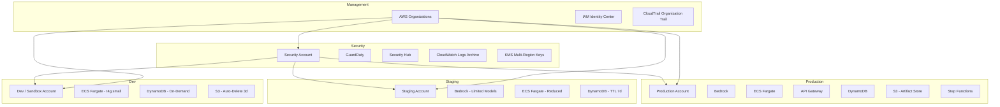

# AgenticOps — AWS Account Structure

## Multi-Account Strategy

## Account Details

| Account | OU | Purpose | Budget | Guardrails |
|---------|----|---------|--------|------------|
| **Management** | Root | Organizations, Identity Center, Organization Trail | N/A | SCPs apply to all |
| **Security** | Security | GuardDuty, Security Hub, KMS, aggregated logs | $5K/mo | Break-glass SCP, MFA required |
| **Production** | Workloads | Customer-facing agent API, production data | $45K/mo | Full SCPs, JIT access only |
| **Staging** | Workloads | Pre-production validation, load testing | $8K/mo | Data masked, reduced Bedrock models |
| **Dev/Sandbox** | Workloads | Engineer experimentation, prompt development | $5K/mo | Auto-delete policies, limited instances |

## SCP Guardrails (Applied at OU Level)

| SCP Name | Effect | Target |
|----------|--------|--------|
| `DenyNonCompliantRegion` | Deny | Only us-east-1, us-west-2, eu-west-1 |
| `DenyRootAccess` | Deny | Block all root user actions |
| `EnforceImdsV2` | Deny | Block IMDSv1 on EC2 |
| `RequireEncryption` | Deny | Block unencrypted S3, EBS, RDS |
| `DenyPublicAccess` | Deny | Block S3 public access, security group ingress from 0.0.0.0/0 |
| `RequireVpcFlowLogs` | Deny | Block VPC creation without flow logs |
| `BreakGlassAiInference` | Deny (conditional) | Blocks all Bedrock/LLM inference when SEV-1 declared |

## Identity & Access Management

- **Authentication**: IAM Identity Center (formerly AWS SSO) with SAML 2.0 + Okta
- **Authorization**: Permission sets mapped to Okta groups
- **MFA**: Required for all human access
- **JIT Elevation**: Production access via IAM Identity Center + temporary credentials (1h TTL)
- **CI/CD Roles**: GitHub Actions OIDC — no long-lived keys
