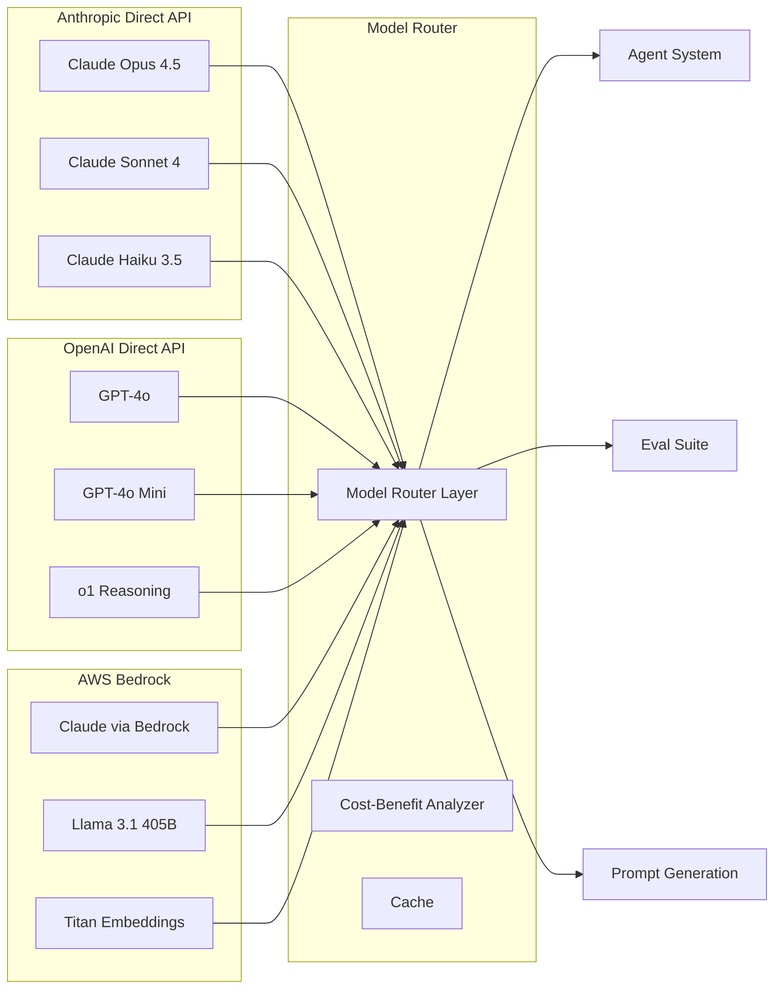

# AgenticOps — Multi-Provider LLM Stack

## Provider Architecture

## Provider Breakdown

| Provider | Models Used | Access Method | Use Case | Monthly Spend |
|----------|-------------|---------------|----------|---------------|
| **Anthropic** | Claude Opus 4.5, Sonnet 4, Haiku 3.5 | Direct API + Bedrock (failover) | Primary agent model (Sonnet), complex reasoning (Opus), cost-sensitive tasks (Haiku) | $18K |
| **OpenAI** | GPT-4o, GPT-4o Mini, o1 | Direct API | Fallback model, structured data extraction (GPT-4o Mini), chain-of-thought reasoning (o1) | $12K |
| **Meta** | Llama 3.1 405B, 70B | AWS Bedrock | Self-hosted option for regulated data, batch offline processing | $3K |
| **Amazon** | Titan Text Embeddings v2 | AWS Bedrock | Embeddings for vector search, semantic caching | $0.5K |

## Model Routing Strategy

The model router selects the optimal provider/model based on:

| Criterion | Evaluation Method | Example Decision |
|-----------|-------------------|------------------|
| **Task type** | Classification (reasoning, extraction, creative, analysis) | Reasoning → Claude Opus / o1; Extraction → GPT-4o Mini |
| **Cost sensitivity** | Token budget per customer tier | Enterprise → Claude Sonnet; Self-serve → Haiku |
| **Latency requirement** | SLA per endpoint | <1s → Haiku / GPT-4o Mini; <3s → Sonnet; No limit → Opus / o1 |
| **Data residency** | Customer contract | EU customers → Bedrock (Frankfurt); US → Direct API |
| **Fallback order** | Health check + latency probe | Primary → Sonnet; Failover → GPT-4o; Secondary → Llama via Bedrock |

## API Key Management

- Keys stored in AWS Secrets Manager with auto-rotation (30d for Anthropic/OpenAI, 90d for AWS)
- Each environment (dev/staging/prod) has separate API keys
- Production keys require human approval for rotation via Change Management ticket
- Budget alerts at 80%/100% of monthly allocation per provider
