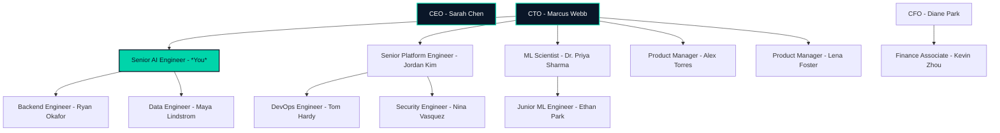

# AgenticOps — Organisational Chart

## Role Responsibilities

| Role | Person | Key Responsibilities |
|------|--------|---------------------|
| **CTO** | Marcus Webb | Technical vision, architecture decisions, board reporting |
| **Senior AI Engineer** | **You** | AI platform design, agent systems, evals, LLM pipeline ownership, mentorship |
| Senior Platform Engineer | Jordan Kim | AWS infrastructure, Terraform, CI/CD, cost governance |
| ML Scientist | Dr. Priya Sharma | Model selection, fine-tuning, eval methodology, research |
| Product Manager | Alex Torres | Brand analytics product, customer requirements |
| Product Manager | Lena Foster | Competitor intelligence product, data partnerships |
| Backend Engineer | Ryan Okafor | API development, integration testing, data pipelines |
| Data Engineer | Maya Lindstrom | ETL, Athena analytics, schema design, data quality |
| DevOps Engineer | Tom Hardy | Kubernetes, monitoring, incident response |
| Security Engineer | Nina Vasquez | IAM, compliance (SOC2/ISO27001), security reviews |
| Junior ML Engineer | Ethan Park | Prompt engineering, dataset curation, eval runs |

## Reporting Lines

- You report directly to the CTO
- You mentor Ryan (backend) and Ethan (junior ML)
- You work closely with Priya on eval methodology
- You partner with Jordan on infrastructure decisions
- You attend product reviews with Alex and Lena
