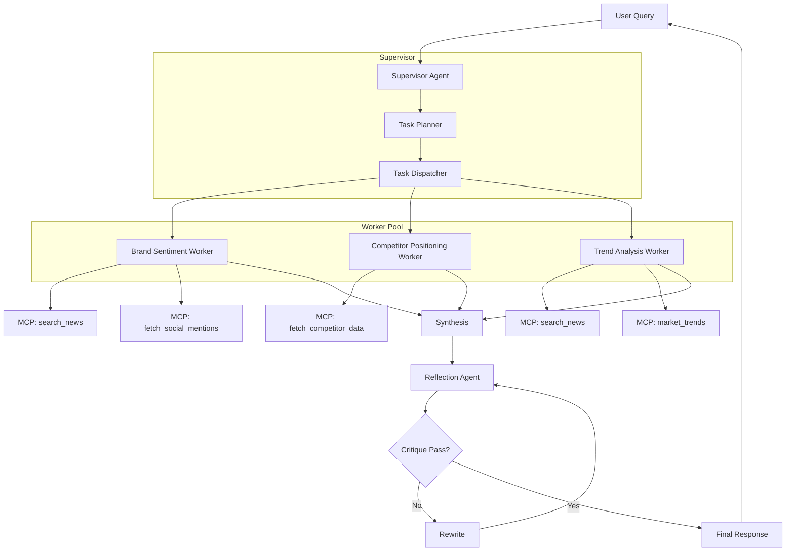
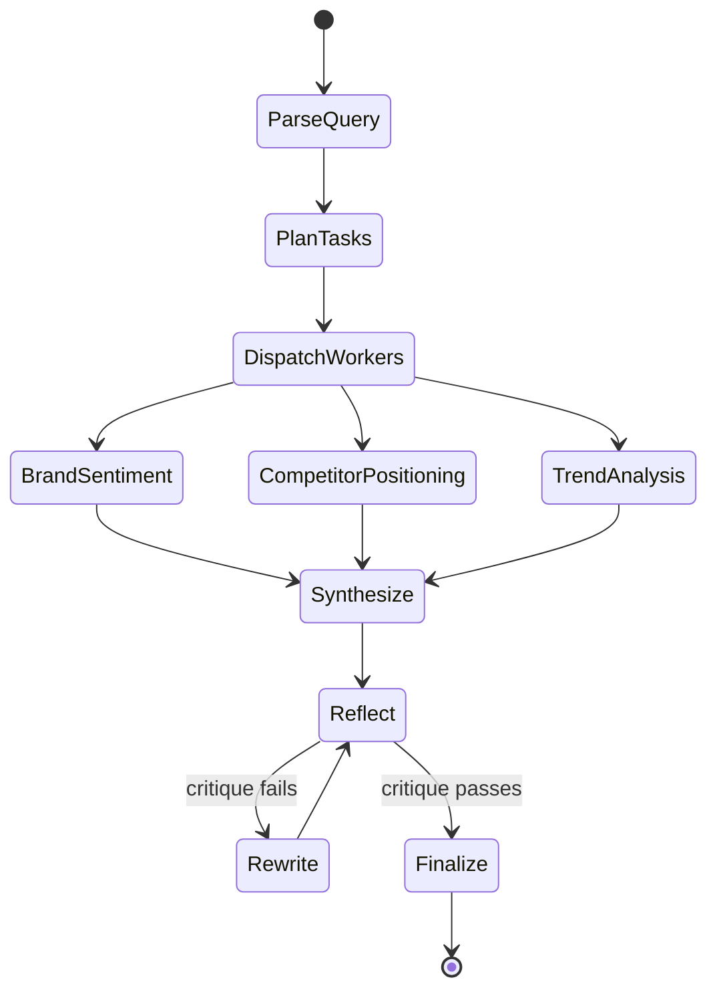

# Scenario 01 — Architecture Design

## Agent Topology



## LangGraph State Graph



## Component Interactions

```
┌─────────────────┐     ┌──────────────────┐     ┌─────────────────┐
│   FastAPI App   │────→│  LangGraph Graph │────→│   MCP Server    │
│  (ECS Fargate)  │     │  (Supervisor)    │     │  (Lambda/ECS)   │
└─────────────────┘     └──────────────────┘     └─────────────────┘
         │                       │                        │
         ↓                       ↓                        ↓
┌─────────────────┐     ┌──────────────────┐     ┌─────────────────┐
│  DynamoDB       │     │  S3 Artifact     │     │  CloudWatch     │
│  Session Store  │     │  Store           │     │  Logs & Metrics │
└─────────────────┘     └──────────────────┘     └─────────────────┘
```

## Data Flow

1. **User query received** via API Gateway → ECS Fargate (FastAPI)
2. **Session created** in DynamoDB (TTL: 1h)
3. **Supervisor agent** parses query, plans tasks using Claude Sonnet
4. **Workers dispatched** — each worker runs in a sub-graph with:
   - 30s timeout
   - Tool access scoped to specific MCP functions
   - Structured output schema (Pydantic)
5. **Results synthesized** by supervisor
6. **Reflection loop** evaluates output quality:
   - Factual accuracy check
   - Completeness check against original query
   - Consistency check across sources
7. **Final response** returned to user, stored in S3 artifact store

## Sandboxing Strategy

| Boundary | Mechanism |
|----------|-----------|
| Worker isolation | Each worker runs as separate LangGraph node with isolated state |
| Tool access | Tool-level IAM; workers can only call permitted tools |
| Execution timeout | 30s per worker, 60s total graph timeout |
| Output validation | Pydantic models at every LLM boundary |
| Data access | Client context injected at session start; workers cannot read other sessions |
