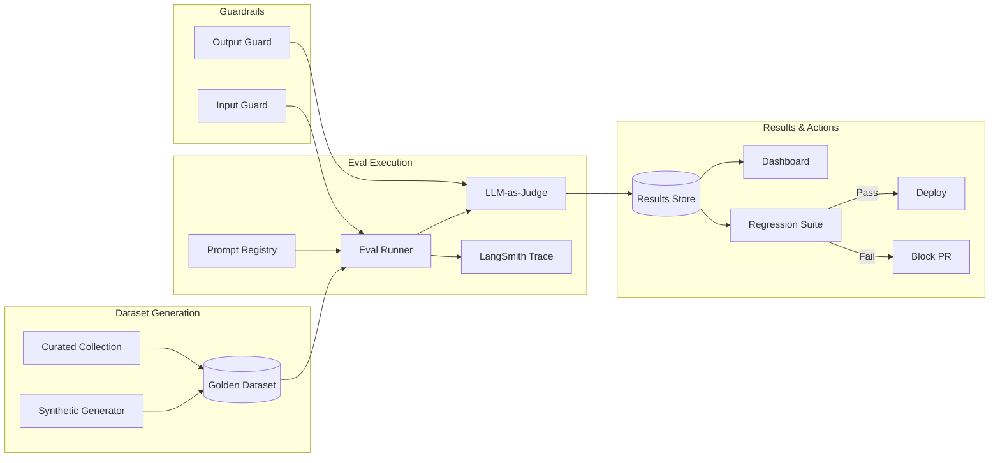
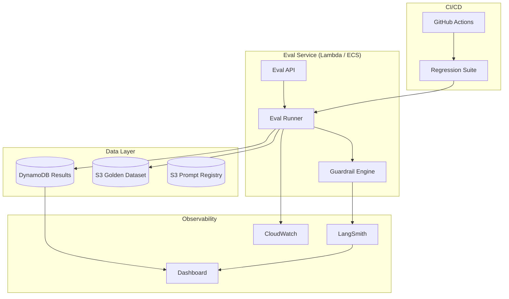

# Scenario 02 — Architecture Design

## Eval Pipeline Flow



## Component Architecture



## Data Model

### Eval Result Schema (DynamoDB)

```json
{
  "eval_id": "ev_20260615_abc123",
  "prompt_hash": "sha256:a1b2c3d4",
  "model": "claude-sonnet-4",
  "dataset_version": "golden_v1",
  "dataset_item_id": "ds_001",
  "input": "Analyze Nike brand sentiment",
  "output": "...",
  "judge_score": 0.92,
  "judge_rubric": {
    "accuracy": 0.95,
    "completeness": 0.90,
    "tone": 0.88,
    "safety": 1.0
  },
  "latency_ms": 2340,
  "cost_usd": 0.0042,
  "token_usage": {
    "input": 450,
    "output": 320,
    "total": 770
  },
  "guardrail_results": {
    "pii_detected": false,
    "injection_detected": false,
    "safety_flagged": false
  },
  "trace_id": "langsmith_trace_xyz",
  "timestamp": "2026-06-15T10:30:00Z"
}
```

## Golden Dataset Design

### Dataset Composition

| Source | Proportion | Examples | Refresh |
|--------|------------|----------|---------|
| **Synthetic** | 60% | LLM-generated variations of common queries | Weekly |
| **Curated real** | 30% | De-identified customer queries from production | Monthly |
| **Edge cases** | 10% | Adversarial inputs, ambiguous queries, multi-intent | Continuous |

### Dataset Schema

```yaml
# prompts/golden_v1/dataset.yaml
version: "1.0"
items:
  - id: ds_001
    category: "brand_sentiment"
    input: "Analyze Nike brand sentiment for Q2 2026"
    expected_components:
      - sentiment_score
      - trend_direction
      - key_drivers
    difficulty: "medium"
    tags: ["nike", "sentiment", "quarterly"]
  
  - id: ds_002
    category: "competitor_comparison"
    input: "Compare brand positioning of Tesla vs Ford"
    expected_components:
      - competitor_analysis
      - market_position
    difficulty: "hard"
    tags: ["automotive", "comparison"]
  
  - id: ds_003
    category: "edge_case"
    input: ""
    expected_error: "empty_input"
    difficulty: "edge"
    tags: ["validation"]
```

## Prompt Registry Design

```yaml
# prompts/registry/brand_sentiment_v2.yaml
version: "2.1"
name: "brand_sentiment_analysis"
created: "2026-06-01"
author: "senior-ai-engineer"

prompt:
  system: |
    You are a brand intelligence analyst at AgenticOps.
    Analyze the brand sentiment for {brand} during {time_period}.
    Output: sentiment score (-1 to 1), trend, key drivers.
  user: "{query}"

overlays:
  low_cost:
    model: "claude-haiku-3.5"
    prompt:
      system: "Briefly analyze {brand} sentiment. One paragraph."
  high_accuracy:
    model: "claude-opus-4.5"
    prompt:
      system: |
        You are a senior brand intelligence analyst.
        Provide a comprehensive analysis of {brand} sentiment.
        Include quantitative scoring and qualitative insights.

tests:
  - dataset: "golden_v1"
    filters:
      category: "brand_sentiment"
  - dataset: "regression_v1"
```
